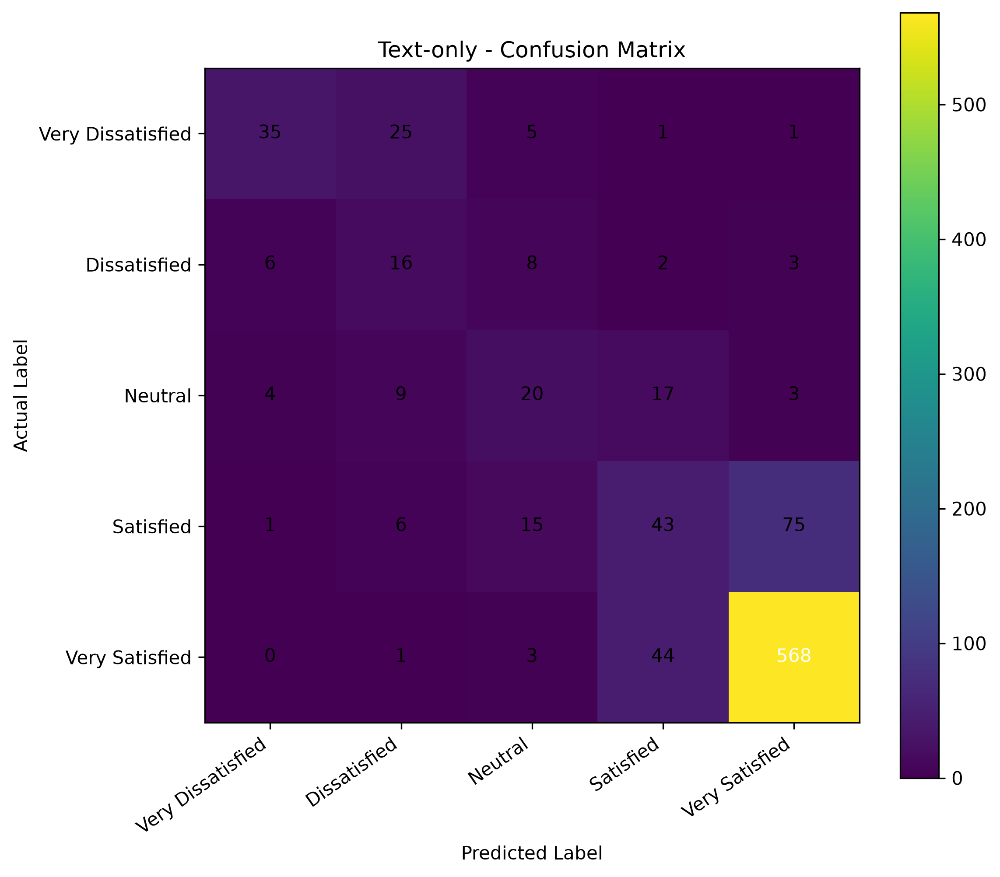
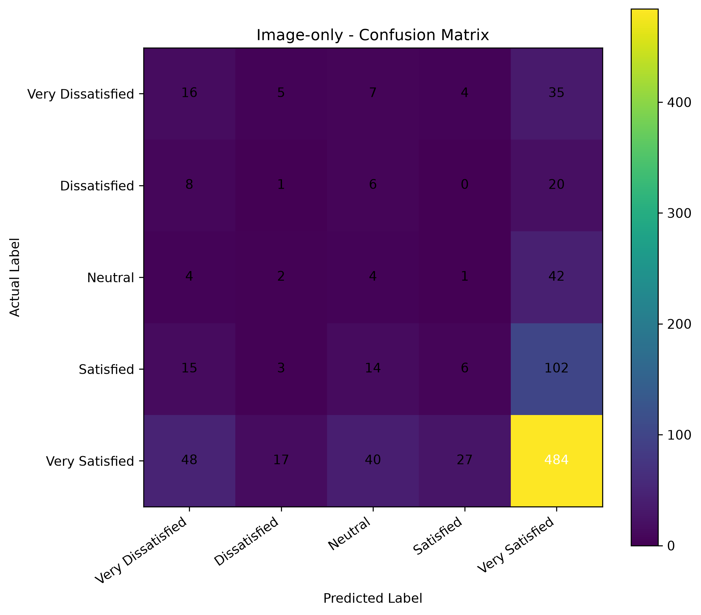
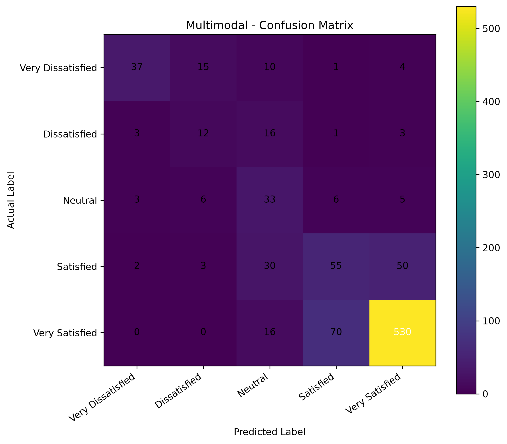
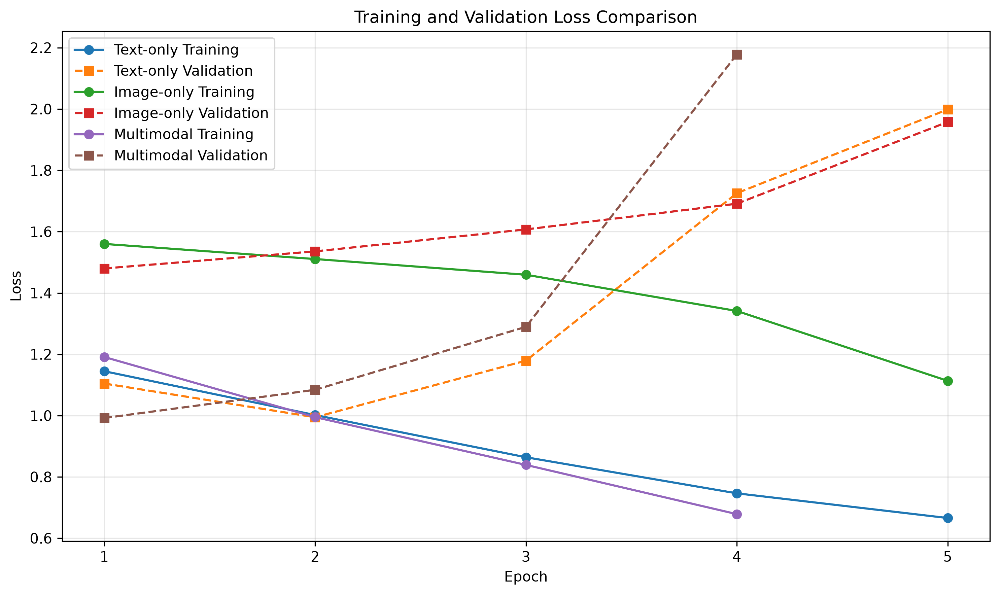
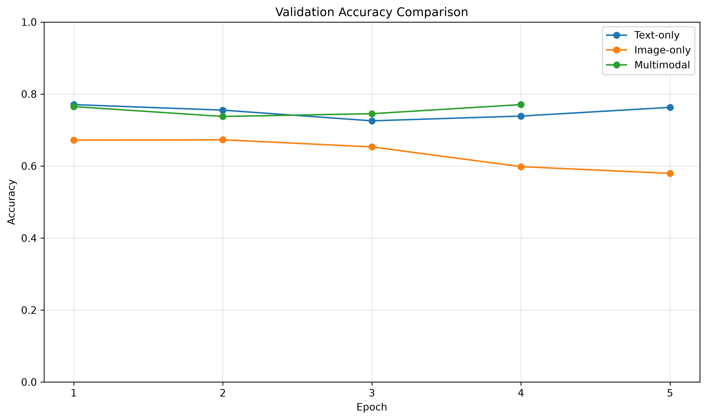
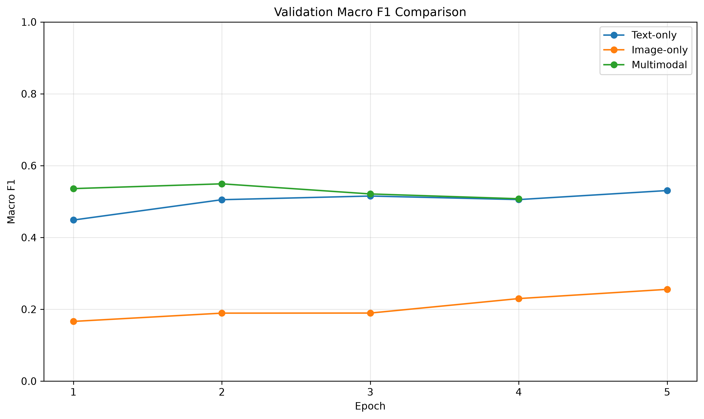
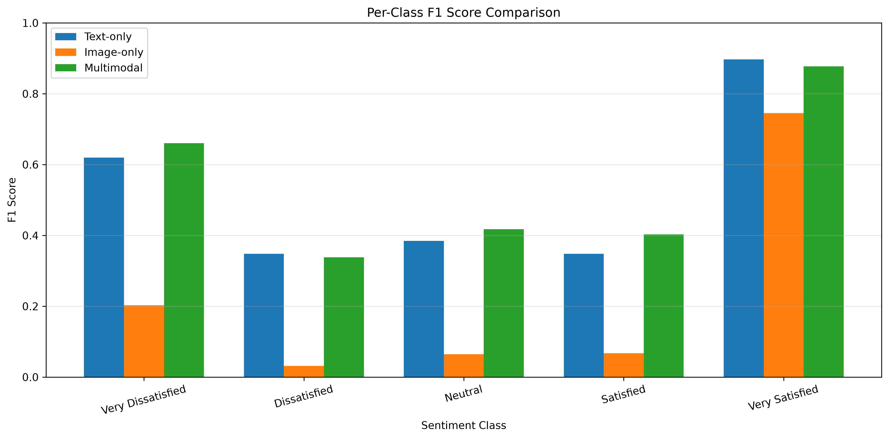

# Multimodal Customer Sentiment Analysis System

## Final Model Evaluation Report

**Generated:** 02 November 2026, 08:12 AM

---

## 1. Dataset Overview

- Dataset: Amazon Reviews 2023 – Electronics
- Original expanded collection: 10,000 image-review pairs
- Clean image-review pairs: 9,105
- Training samples: 7,283
- Validation samples: 911
- Test samples: 911
- Split strategy: Product-aware stratified group splitting
- Product overlap between splits: 0
- Image hash overlap between splits: 0

### Sentiment Classes

| Label | Class |
|---:|---|
| 0 | Very Dissatisfied |
| 1 | Dissatisfied |
| 2 | Neutral |
| 3 | Satisfied |
| 4 | Very Satisfied |

## 2. Model Architectures

| Model | Architecture |
|---|---|
| Text-only | DistilBERT text encoder + classifier |
| Image-only | ResNet18 image encoder + classifier |
| Multimodal | DistilBERT + ResNet18 + feature fusion classifier |

The multimodal model concatenates the 768-dimensional text representation
and 512-dimensional image representation into a 1,280-dimensional feature
vector before classification into five sentiment classes.

## 3. Test Set Performance

| Metric | Text-only | Image-only | Multimodal |
|---|---:|---:|---:|
| Accuracy | 0.7486 | 0.5609 | 0.7322 |
| Macro F1 | 0.5195 | 0.2223 | 0.5394 |
| Weighted F1 | 0.7416 | 0.5341 | 0.7411 |
| Mean Absolute Error | 0.2931 | 0.9407 | 0.3359 |
| Quadratic Weighted Kappa | 0.8575 | 0.1834 | 0.8120 |

### Interpretation

- Text-only achieved the highest accuracy, weighted F1, and QWK.
- Multimodal achieved the highest Macro F1.
- Image-only performed substantially worse than the other models.
- Text appears to be the strongest individual modality in these experiments.
- Fusion provided a modest Macro F1 improvement, but did not improve every metric.

## 4. Per-Class F1 Comparison

| Sentiment Class | Text-only | Image-only | Multimodal |
|---|---:|---:|---:|
| Very Dissatisfied | 0.6195 | 0.2025 | 0.6607 |
| Dissatisfied | 0.3478 | 0.0317 | 0.3380 |
| Neutral | 0.3846 | 0.0645 | 0.4177 |
| Satisfied | 0.3482 | 0.0674 | 0.4029 |
| Very Satisfied | 0.8973 | 0.7452 | 0.8775 |

## 5. Training and Validation Analysis

Best validation Macro F1 scores:

| Model | Best Epoch | Best Validation Macro F1 |
|---|---:|---:|
| Text-only | 5 | 0.5306 |
| Image-only | 5 | 0.2555 |
| Multimodal | 2 | 0.5493 |

The validation loss and Macro F1 plots are available in the comparison folder.

## 6. Confusion Matrices

### Text-only

### Image-only

### Multimodal

## 7. Training Graphs

### Validation Loss

### Validation Accuracy

### Validation Macro F1

### Per-Class F1

## 8. Limitations

1. The dataset has substantial class imbalance, with Very Satisfied
   representing approximately 67.7% of the clean dataset.
2. The image-only model struggled to distinguish minority sentiment classes.
3. The multimodal and text-only models showed signs of overfitting.
4. Image sentiment is not always directly related to review sentiment.
5. Results are based on one product-aware test split and may vary across
   different datasets and product categories.

## 9. Conclusion

The experiments demonstrate that review text is the strongest individual
modality for this dataset. Combining text and image features produced the
highest Macro F1 score, indicating a modest benefit for performance across
the five sentiment classes. However, the text-only model achieved better
accuracy and ordinal agreement. The results support retaining multimodal
fusion as the main project architecture while using text-only and image-only
models as comparison baselines.

---

*This report was generated from the project's saved evaluation reports and
training histories.*